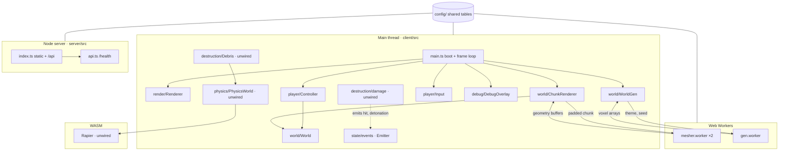
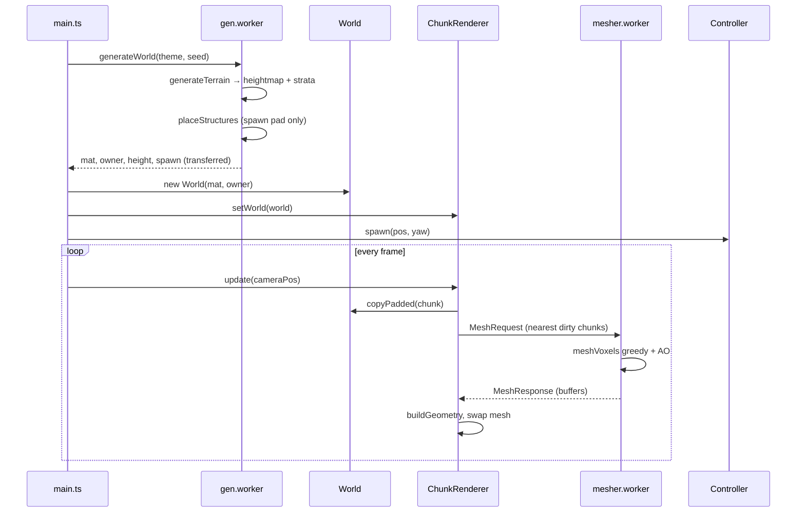
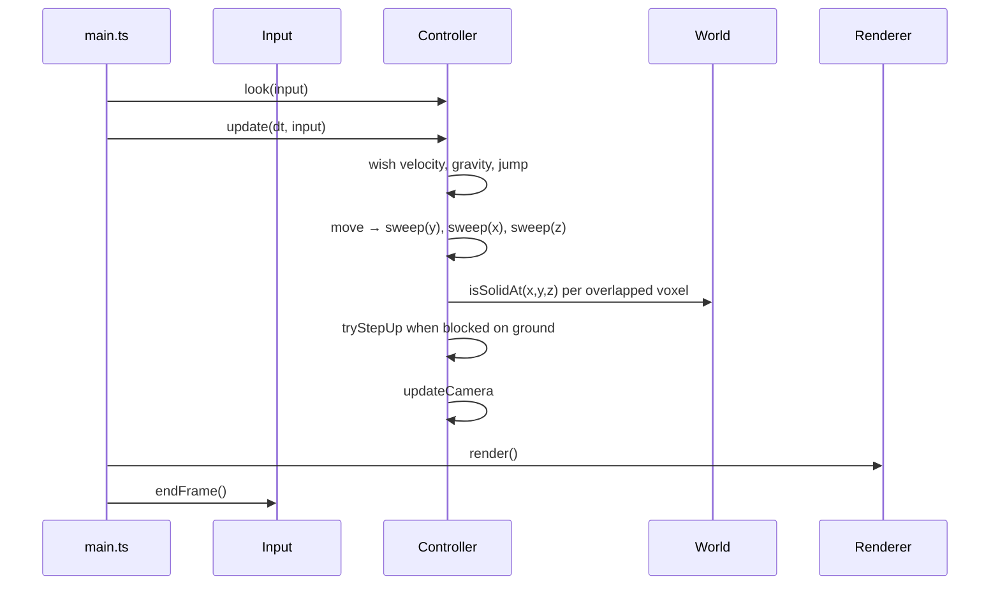
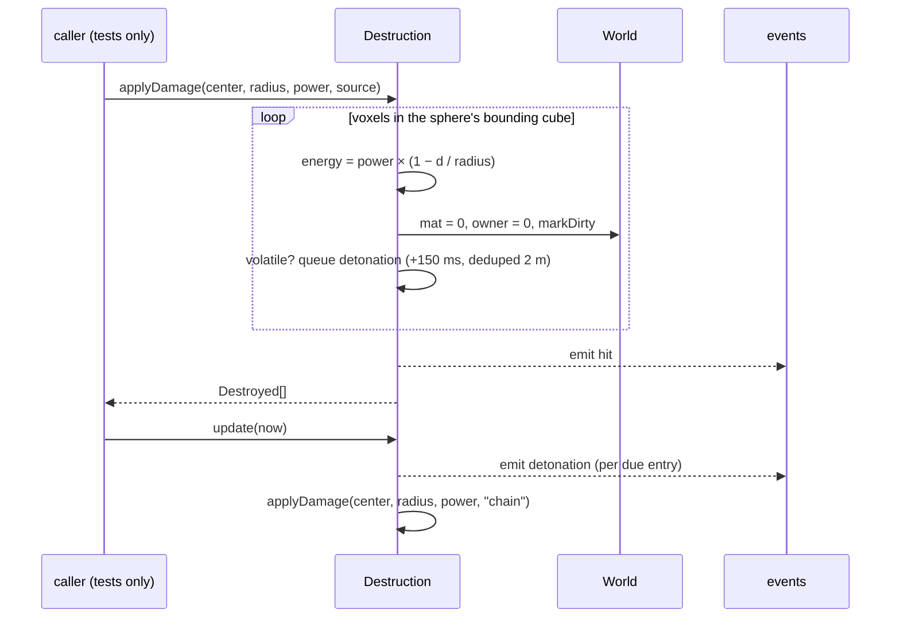
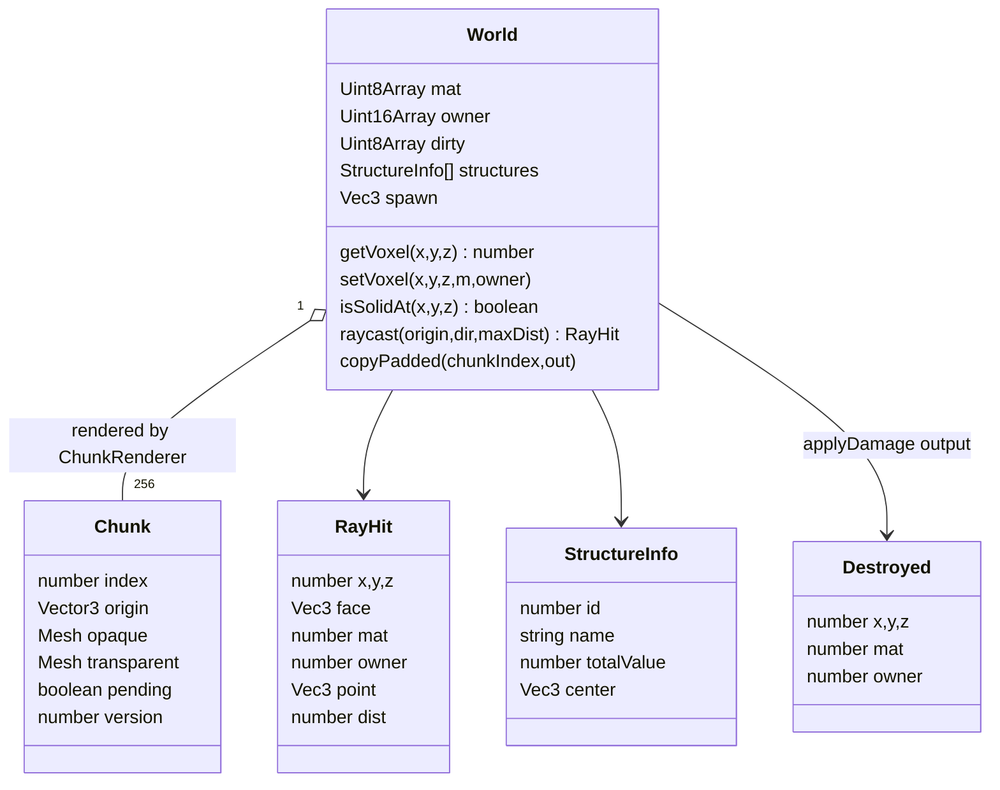
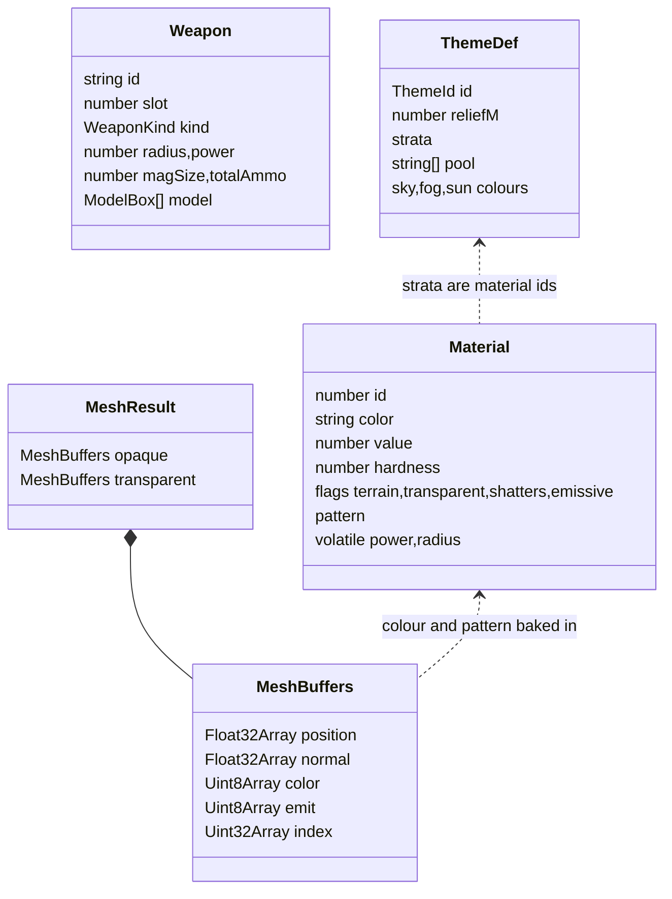

# Voxel Wreck — Developer Tree (living document)

The codebase **as it exists at the current commit**: modules, functions and the paths that run end to end. Code that is written but not wired into the running game is marked **(unwired)**. Modules from SPEC.md with no code are listed at the end under "Planned, not built".

## Architecture

The browser loads the client from the Node server; the client makes no API calls yet.

## Sequence: a world loads and becomes walkable

## Sequence: one frame of player movement

## Sequence: applyDamage (unit-tested, not reachable from gameplay yet)

## Data types: world and destruction

## Data types: mesher output and config tables

## Function tree

Legend: **[main]** main thread · **[worker]** Web Worker · **[server]** Node · **[pure]** usable anywhere · **(unwired)** not called by the running game.

- `config/` **[pure]** — data tables only: `world.ts`, `materials.ts`, `weapons.ts`, `scoring.ts`, `milestones.ts`, `themes.ts`, `player.ts`, `effects.ts`
  - `materialOf(id) → Material | undefined` — lookup
  - `milestoneFor(index) → MilestoneTier` — callout + reward for the nth milestone (unwired)
- `client/src/main.ts` **[main]** — boot: renderer, input, world gen, frame loop, exposes `window.__vw` for probes
- `client/src/render/Renderer.ts` **[main]**
  - `GameRenderer(canvas)` — WebGL2 renderer, camera, sun with shadow map, hemisphere light, overlay scene
  - `resize()` — fit the window
  - `setFov(fov)` — camera FOV
  - `setTheme(theme)` — sky, fog, sun colours from the theme table
  - `render()` — world pass then overlay pass
- `client/src/world/World.ts` **[main]** (also constructed in tests)
  - `voxelIndex(x,y,z) → number`, `chunkIndex(cx,cy,cz) → number` — flat-array indexing
  - `getVoxel(x,y,z) → number` — material id, 0 outside
  - `getOwner(x,y,z) → number` — structure id
  - `isSolidAt(x,y,z) → boolean` — collision query; arena walls and bedrock count as solid
  - `setVoxel(x,y,z,mat,owner)` — write + dirty tracking
  - `markDirty(x,y,z)` — flags the chunk and border neighbours
  - `surfaceY(x,z) → number` — topmost solid voxel
  - `copyPadded(chunkIndex,out)` — 34³ copy with neighbour border for the mesher
  - `raycast(origin,dir,maxDist) → RayHit | null` — Amanatides–Woo DDA
- `client/src/world/Chunk.ts` **[main]**
  - `Chunk(index)` — render state for one 32³ chunk
  - `distSq(point) → number` — remesh priority
- `client/src/world/mesher.ts` **[pure]**
  - `patternFactor(mat,x,y,z) → number` — brick rows, siding, checker, marble tint
  - `meshVoxels(vox, opts) → MeshResult` — greedy quads, vertex AO baked into colour, transparent pass
  - `transferables(result) → ArrayBuffer[]` — buffers to transfer out of a worker
- `client/src/world/mesher.worker.ts` **[worker]**
  - `onmessage(MeshRequest)` — meshes one padded chunk, posts `MeshResponse`
- `client/src/world/VoxelMaterial.ts` **[main]**
  - `createOpaqueMaterial(voxelSize)`, `createTransparentMaterial(voxelSize)` — Lambert + vertex colour + shader-side per-voxel jitter + emissive attribute
  - `buildGeometry(buffers) → BufferGeometry` — wraps worker output
- `client/src/world/ChunkRenderer.ts` **[main]**
  - `ChunkRenderer(world)` — 256 chunks, 2 mesher workers
  - `setWorld(world)` — drop meshes, remesh everything
  - `idle → boolean` — nothing dirty or in flight
  - `update(focus)` — send nearest dirty chunks, up to `perFrame`
  - `send(chunk)`, `onResult(response)` — worker round trip, stale-version guard
  - `dispose()`
- `client/src/world/WorldGen.ts` **[main]**
  - `generateWorld(theme, seed, terrainOnly) → Promise<{world, height, ms}>` — runs the gen worker once
- `client/src/world/gen/gen.worker.ts` **[worker]**
  - `onmessage(GenRequest)` — terrain + placement, posts arrays
- `client/src/world/gen/terrain.ts` **[worker]**
  - `generateTerrain(theme, rng, mat) → {height}` — simplex heightmap, strata fill
  - `desertRoad(x,z,h)`, `surfaceOverride(theme,x,z,noise)`, `fillColumn(...)` — theme overlays
- `client/src/world/gen/placer.ts` **[worker]**
  - `placeStructures(theme, rng, mat, owner, height, terrainOnly) → Placed` — **stub**: returns an empty structure list and a spawn pad at the −z edge
- `client/src/player/Input.ts` **[main]**
  - `Input(canvas)` — key set, mouse buttons, wheel, movement deltas, pointer lock
  - `requestLock()`, `releaseLock()`, `down(code)`, `wasPressed(code)`, `endFrame()`
- `client/src/player/Controller.ts` **[main]**
  - `Controller(world, camera)` — AABB 0.6 × 1.8 m, feet position
  - `spawn(pos, yaw)`, `eye() → Vector3`, `forward() → Vector3`
  - `look(input)` — yaw/pitch from mouse deltas
  - `update(dt, input)` — acceleration, jump, gravity, then `move`
  - `move(dx,dy,dz)` — per-axis sweep with step-up
  - `tryStepUp(axis, d) → boolean`
  - `sweep(axis, d) → boolean` — sub-stepped overlap test against `World.isSolidAt`
- `client/src/debug/DebugOverlay.ts` **[main]**
  - `toggle()`, `set(lines)`, `frame(dtMs)` — fps, worst frame, mesher stats
- `client/src/util/` **[pure]**
  - `rng.ts`: `hashSeed`, `mulberry32`, `rngFromSeed`, `randInt`, `randRange`, `pick`, `voxelHash`, `randomSeedString`
  - `events.ts`: `Emitter.on/off/emit/clear`
  - `color.ts`: `hexToRgb`, `packRgb`, `clamp255`
  - `growable.ts`: `GrowF32`, `GrowU8`, `GrowU32` push/slice
  - `vec.ts`: `Vec3`, `v3`, `dist3`
- `client/src/state/events.ts` **[main]** (unwired) — `GameEvents` type and the shared `events` emitter; only `hit` and `detonation` are emitted anywhere, and nothing subscribes
- `client/src/destruction/damage.ts` **[main]** (unwired; unit-tested)
  - `Destruction(world)`
  - `applyDamage(center, radius, power, source) → Destroyed[]` — sphere carve, glass shatters, volatile queue
  - `update(now)` — fires due detonations as chained `applyDamage` calls
- `client/src/physics/PhysicsWorld.ts` **[main → WASM]** (unwired)
  - `PhysicsWorld.init()`, `create(gravity)` — Rapier init
  - `setTerrain(height)` — static heightfield from the surface
  - `update(dt)` — fixed 60 Hz stepping
- `client/src/destruction/Debris.ts` **[main]** (unwired)
  - `spawn(list, center, power)` — up to 24 cuboids per blast, 300 cap, glass splits smaller
  - `update(now)` — copies body transforms into the InstancedMesh, shrinks and expires
  - `clear()`
- `server/src/index.ts` **[server]** — Hono app: serves `client/dist`, mounts `/api`
- `server/src/api.ts` **[server]** — `GET /api/health → {ok:true}`
- `scripts/screenshots.mjs` — Playwright capture of `?screen=` pages against the built server
- `scripts/dev/probe.mjs` — headless probe that evaluates a script against `window.__vw`

## Built mechanics → implementing function

| Player mechanic (works today) | Function |
| --- | --- |
| Arena generates from theme + seed | `generateWorld` → `generateTerrain` |
| Dunes, road, sidewalk grid, gravel paths | `desertRoad`, `surfaceOverride`, `fillColumn` |
| World appears chunk by chunk, nearest first | `ChunkRenderer.update` → `mesher.worker` |
| Brick rows, siding, marble, per-voxel speckle | `patternFactor`; jitter in `VoxelMaterial` shader |
| Corners look shaded | AO in `meshVoxels` |
| Mouse look after clicking | `Input.requestLock`, `Controller.look` |
| Walk, sprint, jump | `Controller.update` |
| Can't walk through terrain, climbs single steps | `Controller.sweep`, `Controller.tryStepUp` |
| Can't leave the arena | `World.isSolidAt` boundary rule |
| Stats readout (F3) | `DebugOverlay` |

## Planned, not built

Modules in SPEC.md "Project structure" with no code at this commit:

- `client/src/state/` — GameState machine, round clock, stats (only the events type exists)
- `client/src/world/gen/StructureCtx.ts` — box/cylinder/hollowBox helpers + owner tagging
- `client/src/world/gen/recipes/` — every structure recipe
- `client/src/world/gen/placer.ts` — real jittered-grid placement (current file is a spawn-pad stub)
- `client/src/destruction/effects.ts` — shake, flash, particles
- `client/src/physics/PhysicsWorld.ts` — projectiles (heightfield + stepping exist, unwired)
- `client/src/player/Weapons.ts` — fire/swing/throw/place, ammo, reload, radial select
- `client/src/player/ViewModel.ts` — voxel gun meshes, recoil, bob, muzzle flash
- `client/src/scoring/Score.ts` — multiplier, structure registry, milestones
- `client/src/scoring/api.ts` — session/score/leaderboard fetches
- `client/src/audio/Synth.ts` — procedural sfx + stingers
- `client/src/ui/screens/` — Menu, WorldPicker, Loadout, Pause, Results, Initials, Leaderboard
- `client/src/ui/hud/` — ScoreBar, Timer, Radial, Ammo, StructureReadout, Crosshair, Callouts
- `server/src/db.ts`, `server/src/token.ts`, `server/src/validate.ts` — SQLite, HMAC tokens, validation
- `server/src/api.ts` routes `/session`, `/score`, `/leaderboard` (only `/health` exists)

## Changelog

- 2026-11-04: Initial snapshot at 580cf52
