# Voxel Wreck — Developer Tree (living document)

The codebase **as it exists at the current commit**: modules, functions and the paths that run end to end. Modules from SPEC.md with no code are listed at the end under "Planned, not built".

## Architecture

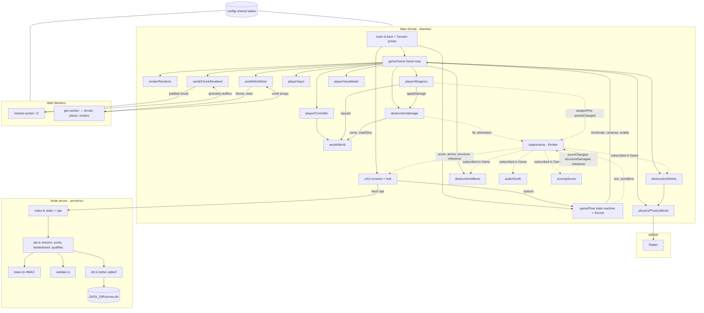

`Game` owns the systems and the frame loop; `Flow` decides each frame whether the player runs (and drives the orbit/countdown cameras); `UI` owns the DOM. Gameplay never touches the DOM: the HUD and screens subscribe to `events`, and `Flow` is the only thing the screens call. The client talks to the server through `scoring/api.ts` for sessions, score submission, the leaderboard and the top-100 check.

## Sequence: a world loads and becomes walkable

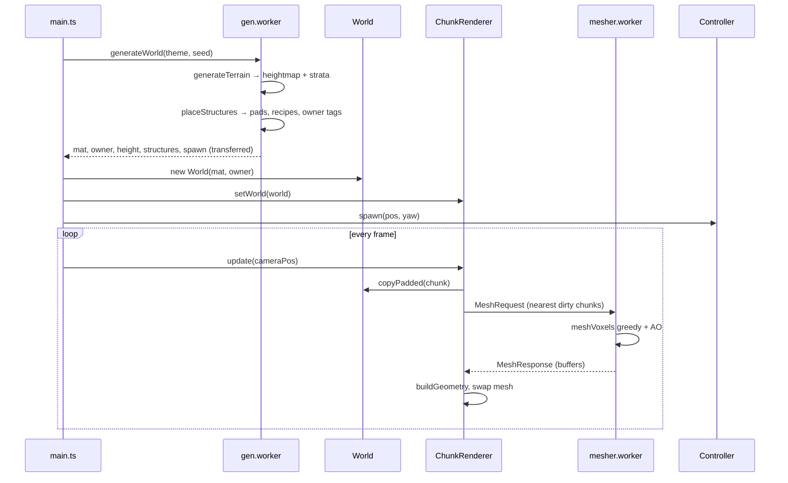

## Sequence: one frame of player movement

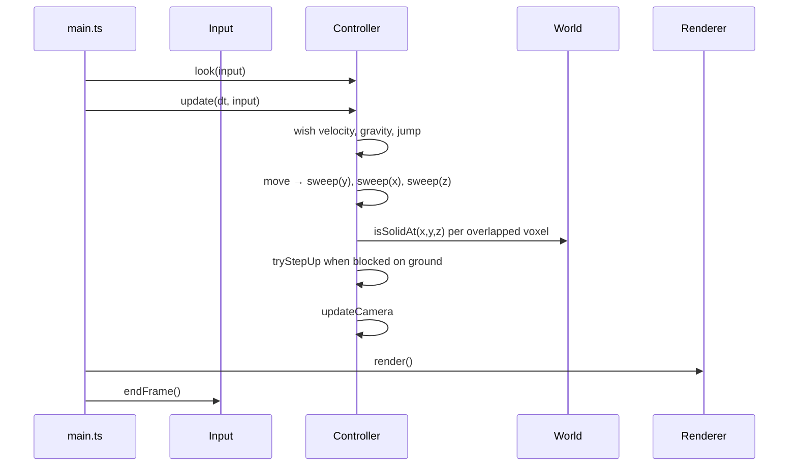

## Sequence: the round lifecycle against the server

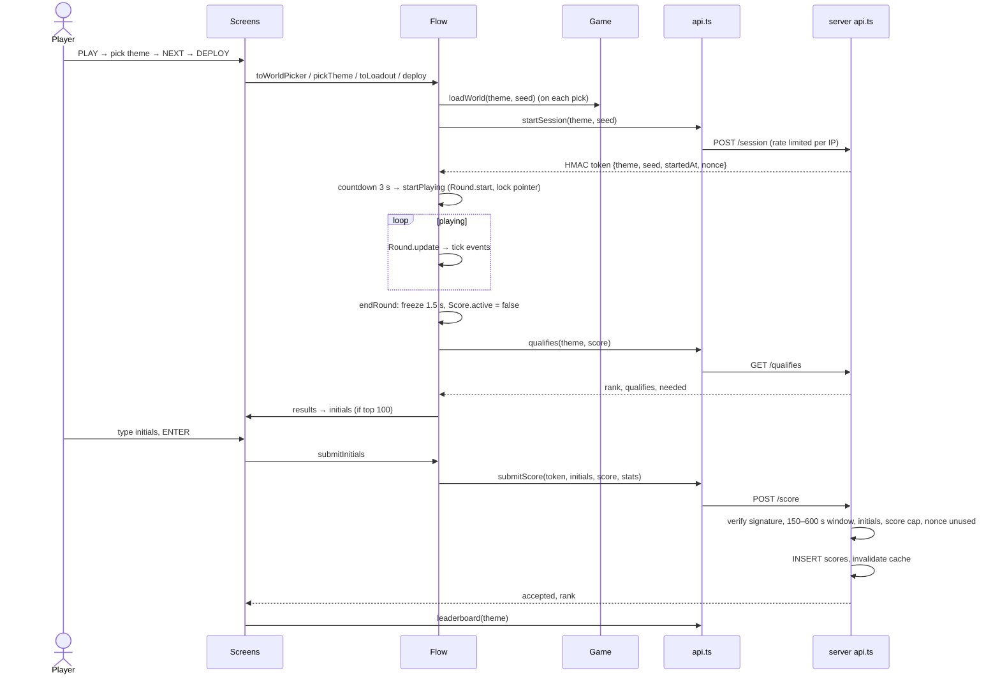

## Sequence: placing one structure (gen.worker)

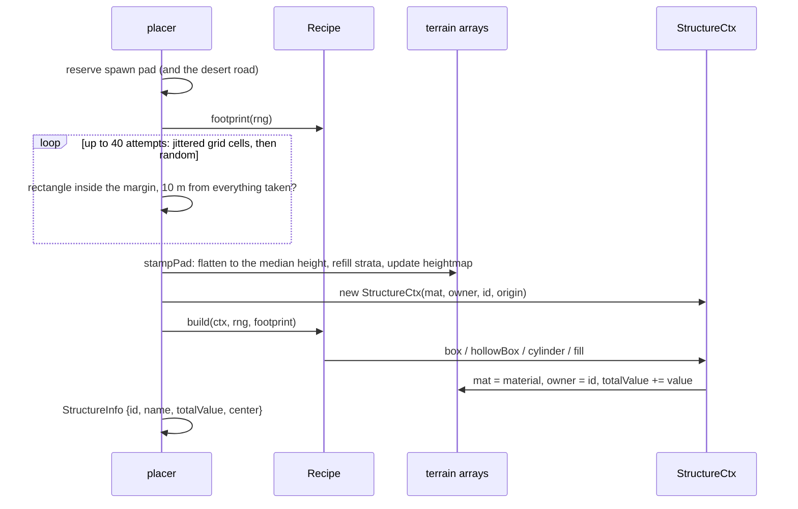

## Sequence: a destroyed voxel becomes points

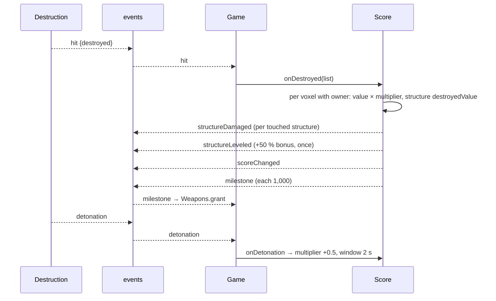

## Sequence: one shot, from click to debris

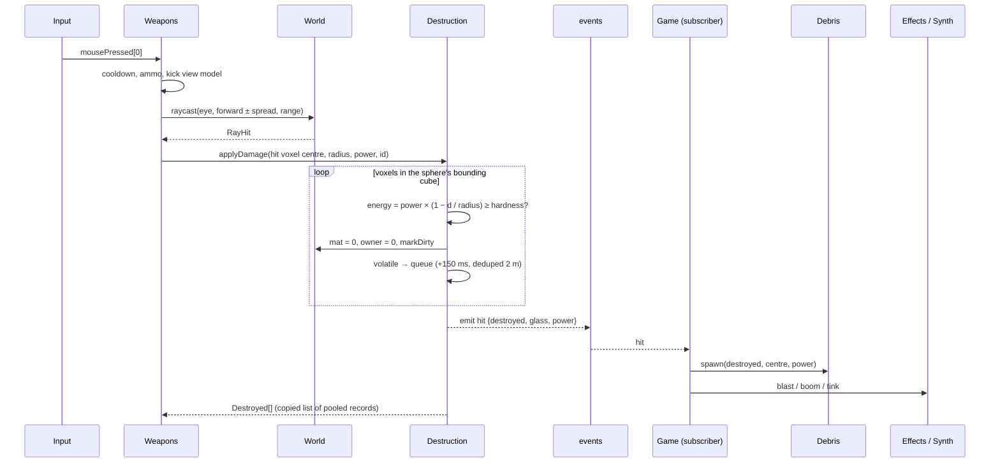

## Sequence: a chain reaction frame

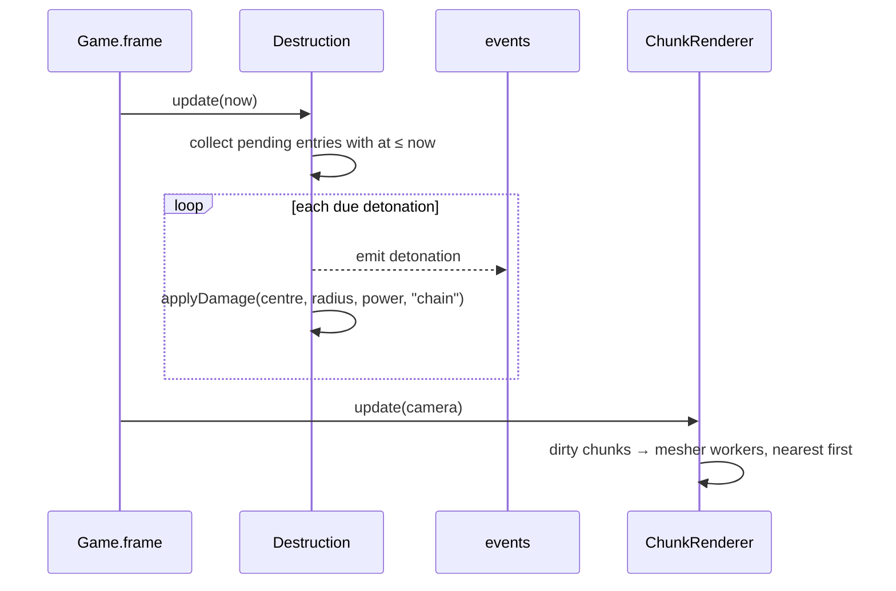

## Sequence: a grenade's life

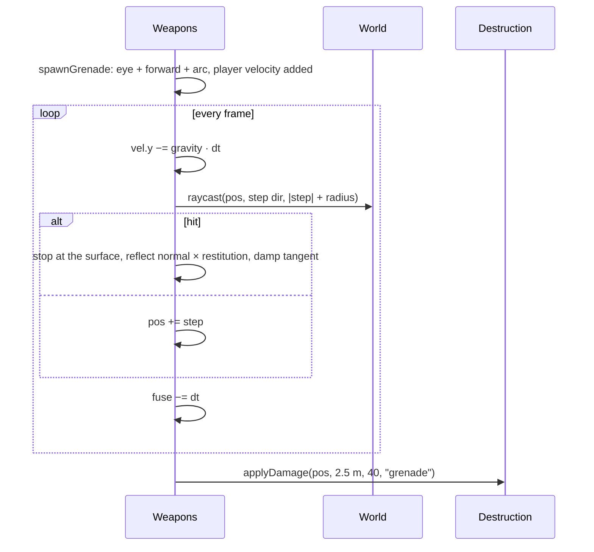

## Data types: world and destruction

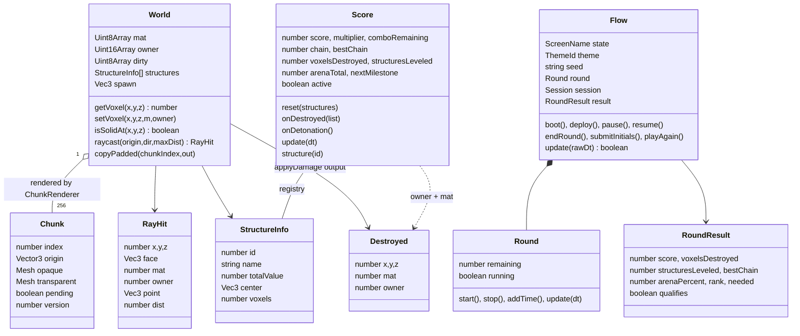

## Data types: mesher output and config tables

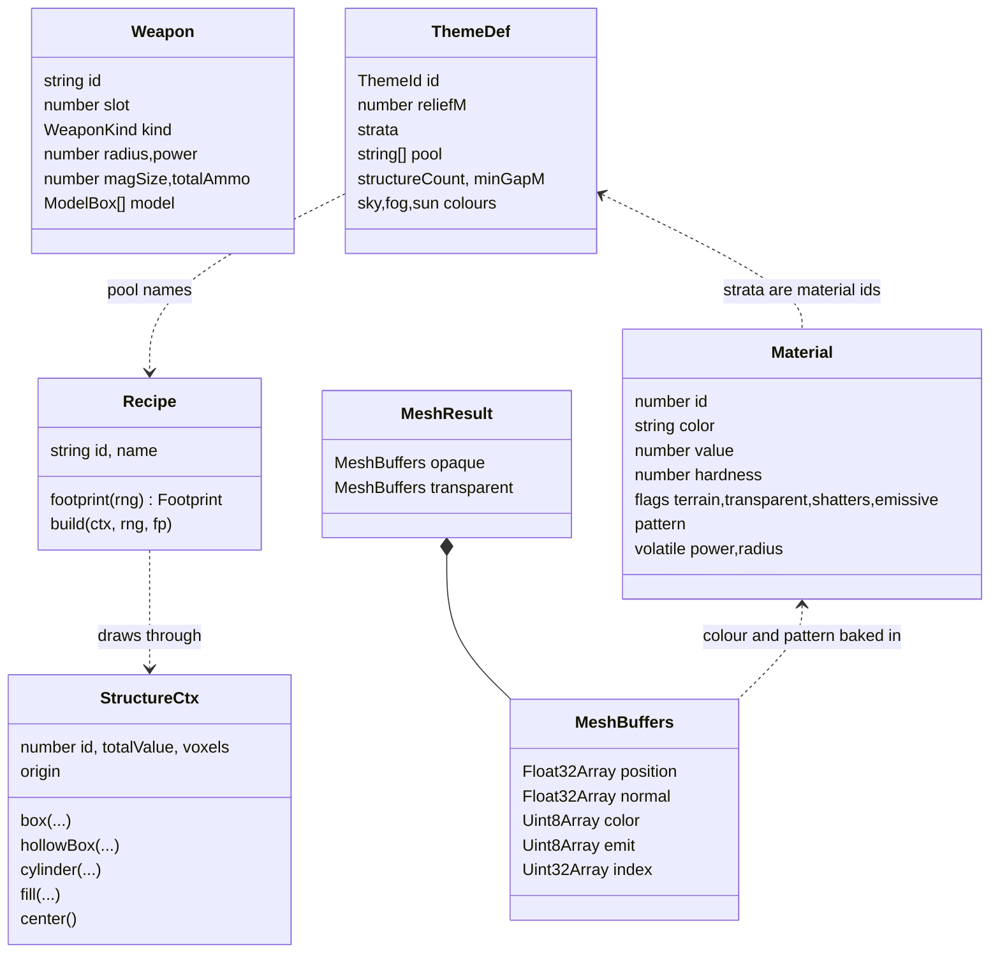

## Function tree

Legend: **[main]** main thread · **[worker]** Web Worker · **[server]** Node · **[pure]** usable anywhere · **(unwired)** not called by the running game.

- `config/` **[pure]** — data tables only: `world.ts`, `materials.ts`, `weapons.ts`, `scoring.ts`, `milestones.ts`, `themes.ts`, `player.ts`, `effects.ts`
  - `materialOf(id) → Material | undefined` — lookup
  - `milestoneFor(index) → MilestoneTier` — callout + reward for the nth milestone (unwired)
- `client/src/main.ts` **[main]** — boot: builds `Game`, reads `?theme&seed&test`, exposes `window.__vw` for probes
- `client/src/game/Flow.ts` **[main]**
  - `Flow(game)` — state machine; subscribes `milestone` (time reward) and pointer-lock loss (pause)
  - `boot(theme?, seed?)` — random arena for the menu backdrop
  - `loadArena()` — regenerate for the current theme + seed (menu, picker, play again)
  - `toMenu()`, `toWorldPicker()`, `pickTheme(id)`, `setSeed(s)`, `randomSeed()`, `toLoadout()`
  - `deploy()` — session from the server, reset weapons/score, countdown
  - `startPlaying()`, `pause()`, `resume()`, `quitToMenu()`
  - `endRound()` — freeze, `roundEnd`, top-100 lookup, `RoundResult`
  - `toResults()`, `afterResults()`, `submitInitials(s)`, `toLeaderboard()`, `playAgain()`
  - `setRadial(open)` — 30 % time scale while the picker is open
  - `canvasClick()` — re-request pointer lock mid-round; `skipCountdown()` — debug
  - `set(state)` also starts/stops the menu music; countdown and end-freeze run on wall-clock deadlines so slow frames do not stretch them
  - `update(rawDt) → boolean` — orbit camera in menus, countdown swoop, clock while playing; returns whether the controller runs
  - `updateFreeze(rawDt)` — moves to results after the slow-motion freeze
- `client/src/state/Round.ts` **[main]**
  - `start()`, `stop()`, `addTime()`, `update(dt) → boolean` — 180 s clock, `tick` once a second, true when it hits zero
- `client/src/scoring/api.ts` **[main]**
  - `api.health()`, `startSession(theme, seed)`, `submitScore(token, initials, score, stats)`, `leaderboard(theme, limit)`, `qualifies(theme, score)`
- `client/src/ui/UI.ts` **[main]**
  - `UI(root, game, flow)` — builds every screen and HUD widget, maps `Flow` states to screens, shows the HUD in a round
  - `showOverlay(screen)` — settings / credits on top of a screen
  - `update(dt, now, game, flow)` — countdown number, radial, crosshair, combo ring, readout timeout
- `client/src/ui/Screen.ts` — `show()/hide()` with enter/leave animation, `onShow()/onHide()`
- `client/src/ui/dom.ts` — `h`, `button`, `fmt`, `tickNumber`, `pop`, `settings.load/save` (localStorage)
- `client/src/ui/screens/` **[main]** — `Menu` (best strip), `WorldPicker` (cards, seed, dice, top scores), `Loadout` (eight scissored model viewports via `renderViews`), `Pause`, `Settings` (sensitivity/volume/FOV sliders), `Credits`, `Results` (count-ups), `Initials` (three columns, typing + arrows), `Leaderboard` (tabs, top 10, highlight)
- `client/src/ui/hud/` **[main]** — `ScoreBar` (score tick, milestone fill, combo badge + ring), `Timer`, `Ammo` (mag/reserve/reload/pips/armed), `Radial` (Q hold, mouse-direction select), `StructureReadout` (3 s, LEVELED stamp), `Crosshair` (spread, hit marker), `Callouts` (milestone slam + flash), `Countdown`
- `client/src/game/Game.ts` **[main]**
  - `Game(canvas, uiRoot)` — constructs every system, subscribes to events
  - `flow`, `uiUpdate`, `afterRender` — hooks the state machine and UI into the frame
  - `init()` — Rapier init, debris pool
  - `loadWorld(theme, seed, terrainOnly)` — generate, install, heightfield, spawn, warm-up, wait for meshes
  - `warmup()` — carves a scratch world and steps physics so first-call JIT/first-contact costs are paid before play
  - `whenMeshed() → Promise` — resolves when no chunk is dirty
  - `start()`, `frame()` — the loop: look, move, weapons, chains, physics, debris, effects, view model, shake, chunks, render
  - `onFrame(fn)` — extra per-frame hooks
  - `stampTestWall()` — `?test=wall` harness: brick wall, fuel tank, propane, glass, concrete
- `client/src/render/Renderer.ts` **[main]**
  - `GameRenderer(canvas)` — WebGL2 renderer, camera, sun with shadow map, hemisphere light, overlay scene
  - `resize()` — fit the window
  - `setFov(fov)` — base camera FOV (settings); `setZoom(mul)` — aim zoom multiplier applied to both cameras
  - `setTheme(theme)` — sky, fog, sun colours from the theme table
  - `render()` — world pass then overlay pass
- `client/src/world/World.ts` **[main]** (also constructed in tests)
  - `voxelIndex(x,y,z) → number`, `chunkIndex(cx,cy,cz) → number` — flat-array indexing
  - `getVoxel(x,y,z) → number` — material id, 0 outside
  - `getOwner(x,y,z) → number` — structure id
  - `isSolidAt(x,y,z) → boolean` — collision query; arena walls and bedrock count as solid
  - `setVoxel(x,y,z,mat,owner)` — write + dirty tracking
  - `markDirty(x,y,z)` — flags the chunk and border neighbours
  - `surfaceY(x,z) → number` — topmost solid voxel
  - `copyPadded(chunkIndex,out)` — 34³ copy with neighbour border for the mesher
  - `raycast(origin,dir,maxDist) → RayHit | null` — Amanatides–Woo DDA
- `client/src/world/Chunk.ts` **[main]**
  - `Chunk(index)` — render state for one 32³ chunk
  - `distSq(point) → number` — remesh priority
- `client/src/world/mesher.ts` **[pure]**
  - `patternFactor(mat,x,y,z) → number` — brick rows, siding, checker, marble tint
  - `meshVoxels(vox, opts) → MeshResult` — greedy quads, vertex AO baked into colour, transparent pass
  - `transferables(result) → ArrayBuffer[]` — buffers to transfer out of a worker
- `client/src/world/mesher.worker.ts` **[worker]**
  - `onmessage(MeshRequest)` — meshes one padded chunk, posts `MeshResponse`
- `client/src/world/VoxelMaterial.ts` **[main]**
  - `createOpaqueMaterial(voxelSize)`, `createTransparentMaterial(voxelSize)` — Lambert + vertex colour + shader-side per-voxel jitter + emissive attribute
  - `buildGeometry(buffers) → BufferGeometry` — wraps worker output
- `client/src/world/ChunkRenderer.ts` **[main]**
  - `ChunkRenderer(world)` — 256 chunks, 2 mesher workers
  - `setWorld(world)` — drop meshes, remesh everything
  - `idle → boolean` — nothing dirty or in flight
  - `update(focus)` — send nearest dirty chunks, up to `perFrame`
  - `send(chunk)`, `onResult(response)` — worker round trip, stale-version guard
  - `dispose()`
- `client/src/world/WorldGen.ts` **[main]**
  - `generateWorld(theme, seed, terrainOnly) → Promise<{world, height, ms}>` — runs the gen worker once
- `client/src/world/gen/gen.worker.ts` **[worker]**
  - `onmessage(GenRequest)` — terrain + placement, posts arrays
- `client/src/world/gen/terrain.ts` **[worker]**
  - `generateTerrain(theme, rng, mat) → {height}` — simplex heightmap, strata fill
  - `desertRoad(x,z,h)`, `surfaceOverride(theme,x,z,noise)`, `fillColumn(...)` — theme overlays
- `client/src/world/gen/placer.ts` **[worker]**
  - `placeStructures(theme, rng, mat, owner, height, terrainOnly) → Placed` — reserves the spawn pad (and the desert road), picks 6–10 recipes from the pool, jittered-grid then random placement with a 10 m gap, stamps pads, builds, returns `StructureInfo[]` + spawn
  - `stampPad(theme, mat, height, rect, h)` — flatten to h, refill strata, keep the heightmap in sync
  - `padHeight(height, rect) → number` — median terrain height under a rectangle
  - `reserved(theme) → Rect[]`, `overlaps(a, b, gap)`
- `client/src/world/gen/StructureCtx.ts` **[worker]**
  - `StructureCtx(mat, owner, id, origin)` — local voxel coordinates, y = 0 on the pad
  - `set(x,y,z,m)` — writes material + owner, keeps `totalValue`, `voxels` and bounds
  - `box(...)`, `hollowBox(..., thickness, floor, roof)`, `cylinder(cx, cz, r, y0, y1, m, hollow)`, `fill(..., fn)` — drawing helpers
  - `center() → Vec3` — metres
- `client/src/world/gen/recipes/` **[worker]** — `Recipe = { id, name, footprint(rng), build(ctx, rng, fp) }`
  - `desert.ts`: `gasStation`, `diner`, `billboard`, `waterTower`, `propaneCage`
  - `downtown.ts`: `convenienceStore`, `officeBlock`, `parkingStructure`, `busShelter`
  - `park.ts`: `monument`, `fountain`, `gazebo`, `statue`, `shed`
  - `index.ts`: `RECIPES` by id
- `client/src/scoring/Score.ts` **[main]**
  - `reset(structures)` — registry and arena total
  - `onDestroyed(list)` — value × multiplier for owned voxels, structureDamaged / structureLeveled events
  - `onDetonation()` — combo step and window
  - `update(dt)` — combo decay
  - `add(delta)` — scoreChanged + milestone events
  - `structure(id)`, `arenaPercent`
- `client/src/player/Input.ts` **[main]**
  - `Input(canvas)` — key set, mouse buttons, wheel, movement deltas, pointer lock
  - `requestLock()`, `releaseLock()`, `down(code)`, `wasPressed(code)`, `endFrame()`
- `client/src/player/Controller.ts` **[main]**
  - `Controller(world, camera)` — AABB 0.6 × 1.8 m, feet position
  - `spawn(pos, yaw)`, `eye() → Vector3`, `forward() → Vector3`
  - `look(input)` — yaw/pitch from mouse deltas
  - `update(dt, input)` — acceleration, jump, gravity, then `move`
  - `move(dx,dy,dz)` — per-axis sweep with step-up
  - `tryStepUp(axis, d) → boolean`
  - `sweep(axis, d) → boolean` — sub-stepped overlap test against `World.isSolidAt`
- `client/src/debug/DebugOverlay.ts` **[main]**
  - `toggle()`, `set(lines)`, `frame(dtMs)` — fps, worst frame, mesher stats
- `client/src/util/` **[pure]**
  - `rng.ts`: `hashSeed`, `mulberry32`, `rngFromSeed`, `randInt`, `randRange`, `pick`, `voxelHash`, `randomSeedString`
  - `events.ts`: `Emitter.on/off/emit/clear`
  - `color.ts`: `hexToRgb`, `packRgb`, `clamp255`
  - `growable.ts`: `GrowF32`, `GrowU8`, `GrowU32` push/slice
  - `vec.ts`: `Vec3`, `v3`, `dist3`
- `client/src/state/events.ts` **[main]** — `GameEvents` type and the shared `events` emitter. Emitted today: `hit`, `detonation`, `weaponFire`, `weaponSwitch`, `ammoChanged`, `placedCharge`. Declared but not yet emitted: `structureDamaged`, `structureLeveled`, `scoreChanged`, `combo`, `milestone`, `roundEnd`, `tick`
- `client/src/destruction/damage.ts` **[main]**
  - `Destruction(world)`
  - `applyDamage(center, radius, power, source) → Destroyed[]` — sphere carve, glass shatters on any energy, volatile queue; records are pooled, the list is a copy
  - `update(now)` — fires due detonations as chained `applyDamage` calls, emits `detonation`
  - `setWorld(world)`, `pendingCount`
- `client/src/physics/PhysicsWorld.ts` **[main → WASM]**
  - `PhysicsWorld.init()`, `create(gravity)` — Rapier init
  - `setTerrain(height)` — static heightfield from the surface (not updated when terrain is carved)
  - `update(dt)` — fixed 60 Hz stepping, at most 2 sub-steps per frame
- `client/src/destruction/Debris.ts` **[main]**
  - `spawn(list, center, power)` — up to 24 cuboids per blast, 300 cap, glass splits smaller; one InstancedMesh with per-instance colour
  - `update(now)` — copies body transforms into the InstancedMesh, shrinks over the last 0.5 s, expires at 4 s
  - `clear()`
- `client/src/destruction/effects.ts` **[main]**
  - `blast(center, power, viewer, glass)` — shake amount from power/distance, additive flash sprite, particle burst
  - `applyShake(camera)` — random offset + roll after the controller placed the camera
  - `update(dt, now)` — decay shake, fade flashes, integrate particles
- `client/src/audio/Synth.ts` **[main]**
  - `prime()` — create the AudioContext and noise buffer early
  - `boom(power, dist)`, `shot(kind)`, `tink(dist)`, `swing(hit)`, `click(pitch)`, `stinger()` — procedural sounds; distance sets gain and low-pass
  - `startMusic()`, `stopMusic()`, `musicPlaying` — four-chord bass + arpeggio loop scheduled a bar at a time (`MUSIC` in config)
  - `setVolume(v)`
- `client/src/player/Weapons.ts` **[main]**
  - `Weapons(world, player, destruction, view)` — eight `WeaponState`s from the config table
  - `update(dt, now, input)` — cooldowns, reload timers, delayed melee resolve, select keys/wheel, R, G, trigger, projectiles
  - `select(i)`, `reload(state)`, `grant(id, n)`, `reset()`, `emitAmmo()`
  - `fire(state) → boolean` — melee swing, hitscan pellets, rocket spawn, grenade throw, C4 place-or-detonate
  - `throwGrenade()` — G from any weapon
  - `centreFor(hit)` — damage centre snapped to the hit voxel's centre
  - `spawnGrenade()`, `updateGrenades(dt)` — hand-rolled ballistics with voxel raycast bounces, fuse
  - `spawnRocket()`, `updateRockets(dt)` — raymarched flight, explodes on contact or at max range
  - `placeCharge(point, face)`, `detonateCharges()` — C4 meshes stuck to faces, all fire together
- `client/src/player/ViewModel.ts` **[main]**
  - `voxelsFromBoxes(boxes, size)`, `buildModelMesh(boxes, size, voxelM) → Group` — tiny voxel models meshed on the main thread with the world mesher
  - `ViewModel(weapons)` — one model per weapon plus two hand blocks and a muzzle-flash quad, attached to the overlay camera
  - `select(id)`, `kick(amount, now, muzzle)`, `startSwing()`, `update(dt, now, moving, speed)` — recoil, bob, swing arc, flash timing
- `server/src/index.ts` **[server]** — Hono app: serves `client/dist`, mounts `/api`
- `server/src/api.ts` **[server]**
  - `createApi({db, signer, skipTimeCheck, now}) → Hono` — `GET /health`; `POST /session` (10/min per IP, signed token); `POST /score` (signature, 150–600 s window, initials + profanity, per-theme cap, single-use nonce, IP hash only); `GET /leaderboard?theme&limit` (5 s cache); `GET /qualifies?theme&score`
- `server/src/db.ts` **[server]**
  - `Db(file)` — `scores` table with `(theme, score DESC)` index, `used_tokens`, WAL
  - `insertScore(row)`, `top(theme, limit)`, `rankFor(theme, score, prospective)`, `cutoff(theme)`, `useToken(nonce, now)`, `pruneTokens(now, maxAge)`, `close()`
- `server/src/token.ts` **[server]**
  - `TokenSigner(secret)` — `sign(payload)`, `verify(token)` (timing-safe), `TokenSigner.nonce()`
  - `resolveSecret(env)` — `SCORE_SECRET` or a random per-process secret with a warning
- `server/src/validate.ts` **[server]**
  - `cleanInitials(s)` — `^[A-Z ]{3}$`, profanity → `???`
  - `validScore(theme, score)` — integer, 0 … themeMax × 5
  - `validElapsed(startedAt, now, skip)` — 150–600 s
  - `RateLimiter(limit, windowMs).allow(key, now)`
  - `isTheme(t)`, `maxScoreFor(theme)`
- `scripts/screenshots.mjs` — Playwright capture of `?screen=` pages against the built server
- `scripts/dev/probe.mjs` — headless probe that evaluates a script against `window.__vw`

## Built mechanics → implementing function

| Player mechanic (works today) | Function |
| --- | --- |
| Arena generates from theme + seed | `generateWorld` → `generateTerrain` |
| Dunes, road, sidewalk grid, gravel paths | `desertRoad`, `surfaceOverride`, `fillColumn` |
| World appears chunk by chunk, nearest first | `ChunkRenderer.update` → `mesher.worker` |
| Brick rows, siding, marble, per-voxel speckle | `patternFactor`; jitter in `VoxelMaterial` shader |
| Corners look shaded | AO in `meshVoxels` |
| Mouse look after clicking | `Input.requestLock`, `Controller.look` |
| Walk, sprint, jump | `Controller.update` |
| Can't walk through terrain, climbs single steps | `Controller.sweep`, `Controller.tryStepUp` |
| Can't leave the arena | `World.isSolidAt` boundary rule |
| Stats readout (F3) | `DebugOverlay` |
| Switch weapon (1–8, wheel) | `Weapons.update` → `Weapons.select` |
| Pickaxe / bat swing | `Weapons.fire` (melee) → `resolveMelee` → `applyDamage` |
| Pistol / shotgun / rifle shots, spread, aim tightens spread | `Weapons.fire` (hitscan) → `spreadDir` → `World.raycast` → `applyDamage` |
| Rocket flight and impact | `spawnRocket`, `updateRockets` |
| Grenade arc, bounce, fuse; G from any weapon | `spawnGrenade`, `updateGrenades`, `throwGrenade` |
| C4 placement and group detonation | `placeCharge`, `detonateCharges` |
| Reload and ammo counts | `Weapons.reload`, `Weapons.update`, `emitAmmo` |
| Sphere carving by material hardness | `Destruction.applyDamage` |
| Glass shatters on any hit | `shattersOf` check in `applyDamage` |
| Fuel / propane / transformer chain reactions | volatile queue in `applyDamage`, `Destruction.update` |
| Debris cubes that tumble on the terrain | `Debris.spawn`, `Debris.update`, `PhysicsWorld.setTerrain` |
| Screen shake, flash, sparks | `Effects.blast`, `Effects.applyShake`, `Effects.update` |
| Boom, gunshot, glass tink, swing whoosh, clicks | `Synth.*`, routed in `Game.subscribe` |
| Gun in hand with recoil, bob, muzzle flash | `ViewModel.*` |
| Test wall with tank behind it (`?test=wall`) | `Game.stampTestWall` |
| Six to ten structures per arena, same seed same arena | `placeStructures`, `RECIPES` |
| Buildings stand on flattened pads | `stampPad`, `padHeight` |
| Each structure's voxels carry its id and its value is known | `StructureCtx.set` |
| Structure voxels pay value × multiplier, terrain pays nothing | `Score.onDestroyed` |
| Combo multiplier from chain detonations, 2 s window | `Score.onDetonation`, `Score.update` |
| Leveled bonus, once per structure | `Score.onDestroyed` |
| Milestones every 1,000 with ammo rewards and a stinger | `Score.add`, `Game.subscribe` → `Weapons.grant` |
| +5 s milestone reward | `Flow` → `Round.addTime` |
| Menu over an orbiting live arena | `Flow.update` (menu states), `Flow.boot` |
| Theme cards rebuild the arena, seed + dice | `WorldPickerScreen`, `Flow.pickTheme`, `Flow.setSeed` |
| Loadout briefing with spinning models | `LoadoutScreen.renderViews` |
| 3-2-1 countdown with the camera dropping in | `Flow.update` (countdown), `Countdown` |
| 3:00 clock, red under 30 s | `Round`, `Timer` |
| Score bar, combo badge and ring | `ScoreBar` |
| Radial picker with slow motion | `Radial`, `Flow.setRadial` |
| Ammo panel, pips, ARMED | `Ammo` |
| Structure readout and LEVELED stamp | `StructureReadout` |
| Crosshair spread and hit markers | `Crosshair` |
| Milestone callouts and screen flash | `Callouts` |
| Esc pauses, pointer-lock loss pauses | `UI` keydown, `Input.onLockChange` → `Flow.pause` |
| Settings remembered between visits | `SettingsScreen`, `settings.save` |
| Slow-motion round end, results count-up | `Flow.endRound`, `Flow.updateFreeze`, `ResultsScreen` |
| Top-100 check, initials, submission, leaderboard tabs | `Flow.endRound` → `api.qualifies`, `InitialsScreen`, `Flow.submitInitials`, `LeaderboardScreen` |
| Scores survive a restart; forged or replayed scores are rejected | `Db`, `TokenSigner`, `validate.ts`, `createApi` |
| Contextual placement (roadside, blocks, paths, hills) | `candidates` in `placer.ts`, `Recipe.siting` |
| Voxel outlines, bevel, hatch | `VoxelMaterial` fragment shader |
| Menu music loop | `Synth.startMusic`, `Flow.set` |
| Aim zoom | `Game.frame` → `GameRenderer.setZoom` |
| Control hint during countdown and the first seconds | `UI` (`hud-hint`) |
| Desktop-only notice on touch devices | `main.ts` |
| Esc during a round pauses; Esc on pause resumes (debounced); click re-locks | `Input.onLockChange`, `UI` keydown, `Flow.canvasClick` |

## Planned, not built

Modules in SPEC.md "Project structure" with no code at this commit:

## Changelog

- 2026-11-04: Phase 6 — music loop, aim zoom, hints, notice, wall-clock UI timers
- 2026-11-04: Phase 5 — db.ts, token.ts, validate.ts, real api.ts; server subgraph and lifecycle sequence updated
- 2026-11-04: Phase 4 — Flow, Round, api.ts, in-memory server routes, UI root, nine screens, eight HUD widgets; contextual siting and the outline shader; round lifecycle sequence
- 2026-11-04: Phase 3 — StructureCtx, placer, 14 recipes, Score wired into Game; placement and scoring sequences
- 2026-11-04: Phase 2 — Game loop, Weapons, ViewModel, Destruction wired, Debris on Rapier heightfield, Effects, Synth; sequences for a shot, a chain frame and a grenade
- 2026-11-04: Initial snapshot at 580cf52
