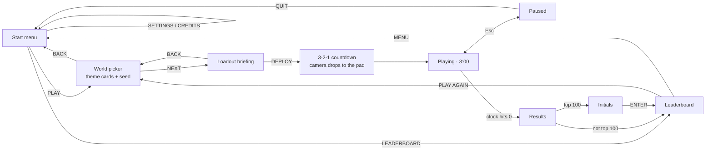
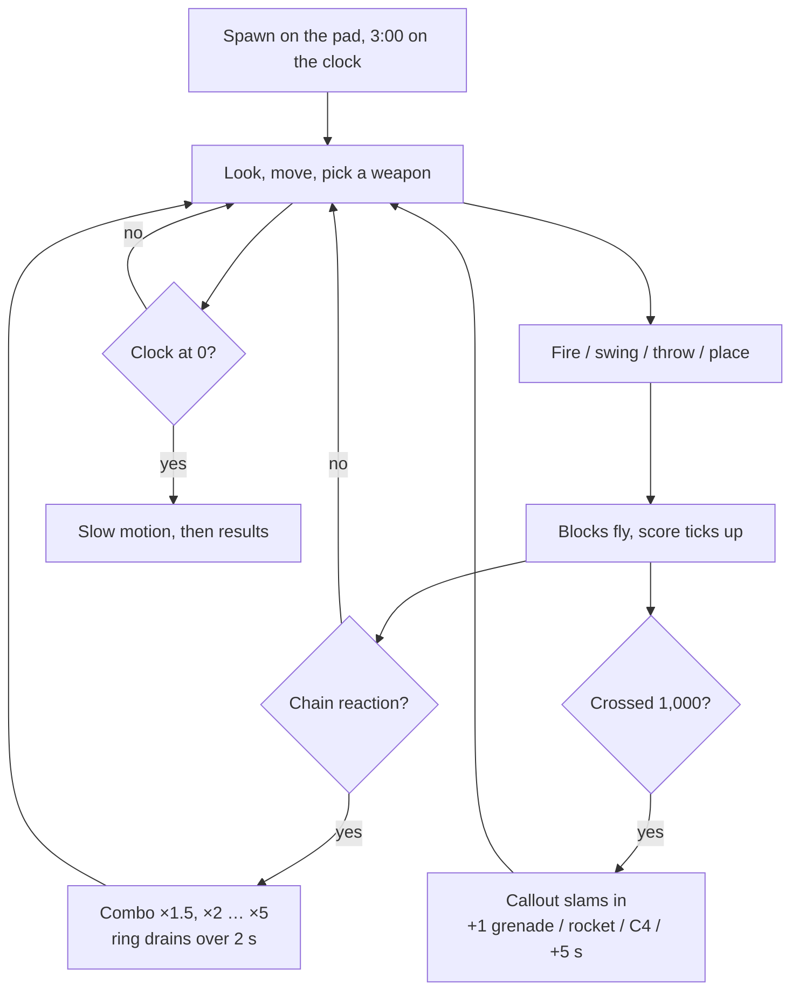
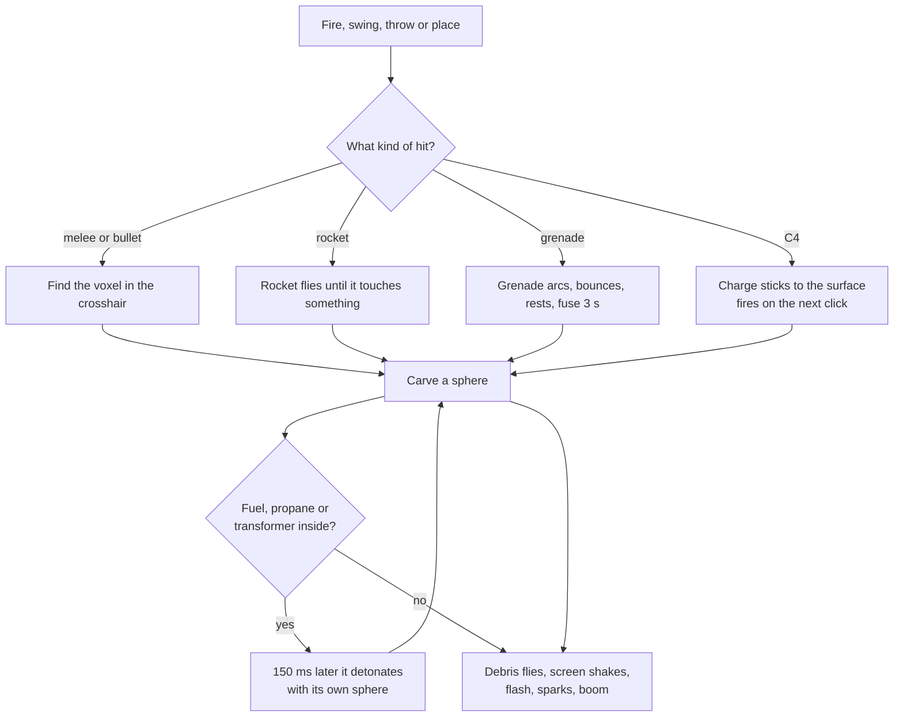
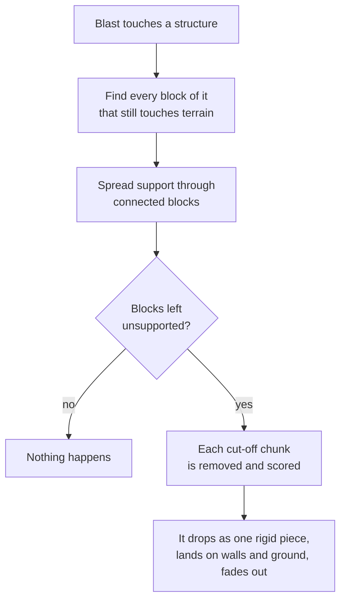
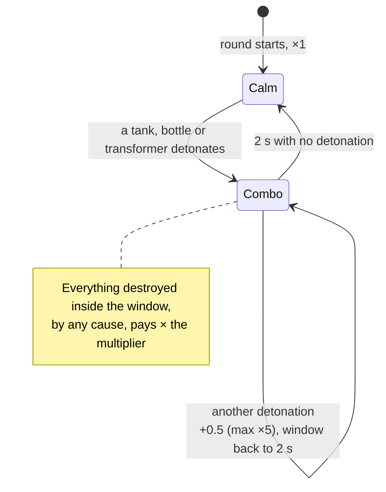
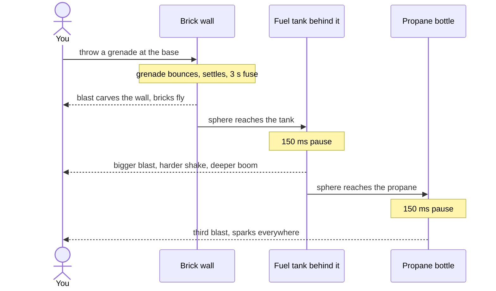
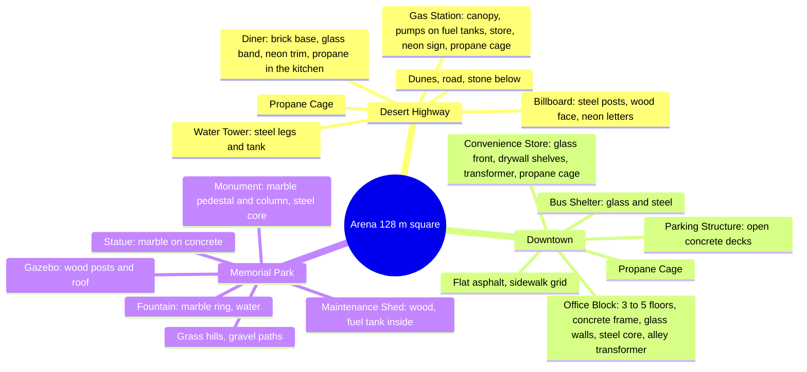

# Voxel Wreck — Player Flow (living document)

This describes the game **as a player experiences it at the current commit**. Nothing here is drawn ahead of the build. Missing mechanics are listed at the end under "Not yet playable".

## Screens

The game is a loop of screens over a live arena. The menu, picker, loadout and leaderboard float over a slowly orbiting view of the arena that will be (or was) played.

What each screen does:

- **Start menu**: title, PLAY / LEADERBOARD / SETTINGS / CREDITS, and a "best" strip with the top score on record. A synth music loop plays on every screen outside the round (it starts after the first click, as browsers require).
- **Phones and tablets** get a "desktop only" notice instead of the game.
- **World picker**: three theme cards (name, description, top score), a seed field with a dice button. Clicking a card rebuilds the arena behind the screen so you see what you picked.
- **Loadout**: the eight slots with spinning models, ammo and role, plus the arena's total points standing and the round length. FIXED KIT is the default; POINT-BUY opens a 128-point budget where every slot has +/− buttons with a price per round, plus a STICKY GRENADES upgrade. Point-buy rounds score on their own leaderboard. DEPLOY.
- **Countdown**: 3, 2, 1, WRECK! while the camera swoops down onto the spawn pad, with a one-line control hint that stays for the first few seconds of the round.
- **Pause**: Esc releases the mouse; RESUME / SETTINGS (sensitivity, volume, FOV, remembered) / QUIT TO MENU.
- **Results**: a 1.5 s slow-motion freeze, then structures leveled, voxels destroyed, biggest chain, arena wrecked and the final score count up. Says whether you made the top 100 or how many more points you needed.
- **Initials**: three arcade letter columns. Type, or use the arrows; ENTER submits.
- **Leaderboard**: tabs per theme plus ALL and POINT-BUY, top 10, your row highlighted, PLAY AGAIN. Clicking a row replays that arena. SHARE ARENA (also on the results screen) copies a link that opens the picker with the same theme and seed. Scores are kept on the server; a score only counts if it comes from a real round (a signed session, submitted once, between 2.5 and 10 minutes after deploying, under a per-theme ceiling). Rude initials become `???`.

## The in-round loop

## The HUD

- **Top**: score bar with the running score, the next milestone and a fill racing toward it; it flashes on every hit. A combo badge with a draining ring appears during chains.
- **Top right**: the clock, red and pulsing under 30 s.
- **Bottom left**: the current weapon's slot number and name. Holding Q fans all eight out in a circle, mouse direction highlights one, release selects it; the game runs at 30 % speed while it is open.
- **Bottom right**: magazine and reserve, a reload bar, grenade and C4 pips, "N ARMED" while C4 charges are placed. Red when empty.
- **Centre bottom**: structure readout for 3 s after a hit ("GAS STATION 78 % · 1,240 pts") and a LEVELED stamp.
- **Centre**: crosshair that spreads for the shotgun and tightens while aiming; a hit marker ticks on every destroyed block.

## Wrecking something

Every hit, from a pickaxe tap to a C4 charge, carves a sphere out of the world. Harder materials need more energy, and energy fades toward the edge of the sphere.

## When a building loses its legs

After every blast, the game checks whether what is left of that structure still reaches the ground. Anything cut off falls as one piece and pays out as if you had destroyed it.

Debris also bounces off walls now, not only the ground.

## Scoring as it works now

Only structure voxels pay. Terrain is free to dig. Each destroyed structure voxel pays its material's value (glass 1 … steel 8) times the current combo multiplier.

Leveling a structure (100 % of its value destroyed) pays a one-time bonus of half its total value. Every 1,000 points is a milestone: a callout slams across the screen, a stinger plays and a reward drops, cycling +1 grenade → +1 rocket → +1 C4 → +5 s on the clock. Several milestones earned at once are announced one after another.

## A dramatic moment: grenade through a brick wall

## Controls that work

| Key | Action |
| --- | --- |
| Mouse | Look (after clicking the view) |
| W A S D | Move |
| Shift | Sprint |
| Space | Jump |
| Mouse 1 | Fire, swing, throw, place C4 (click again to detonate) |
| Mouse 2 | Aim: the view zooms in and spread tightens (C4: detonate) |
| 1–8, wheel | Switch weapon |
| Q (hold) | Radial weapon picker, slow motion |
| R | Reload |
| G | Throw a grenade from any weapon |
| Esc | Pause (and release the mouse) |
| F3 | Toggle the stats readout |

## The loadout

Everyone carries the same eight slots. Ammo is for the whole round; nothing refills yet.

| Slot | Weapon | How it hits | Good against | Ammo |
| --- | --- | --- | --- | --- |
| 1 | Pickaxe | Short swing, one voxel at a time | Anything up to concrete, slowly | Unlimited |
| 2 | Bat | Wide slow swing | Glass, drywall, wood | Unlimited |
| 3 | Pistol | One voxel per shot | Glass, drywall, wood; sets off tanks | 12 per mag, 72 total |
| 4 | Shotgun | Eight pellets in a cone | Walls up close, even concrete | 6 per mag, 30 total |
| 5 | Rifle | Full auto, 10 per second | Brick and concrete | 30 per mag, 120 total |
| 6 | Rocket launcher | Explodes on contact, 3 m sphere | Whole walls at range | 6 |
| 7 | Grenade | Bounces, 3 s fuse, 2.5 m sphere (sticky upgrade: stops where it lands) | Rooms and anything soft | 8 |
| 8 | C4 | Stuck to a surface, 4 m sphere, all charges fire together | Concrete | 4 |

## The arenas and what stands in them

Same theme and seed always build the same arena. Structures never float: each stands on a pad flattened into the terrain. Each theme totals roughly 15,000 (park) to 100,000 (downtown) points.

## Not yet playable

Mechanics from SPEC.md that do not exist for the player at this commit:

- Live low-res renders on the theme cards (cards are stylised art; the arena behind the picker is the live one).
- Debris passing through glass (walls are solid for debris, glass is not).

## Changelog

- 2026-11-04: Phase 7 — structural collapse, debris bouncing off walls, point-buy loadouts with their own board, sticky grenades, share links
- 2026-11-04: Phase 6 — menu music, aim zoom, control hints, desktop-only notice, pointer-lock robustness
- 2026-11-04: Phase 5 — scores persist on the server with signed sessions and validation
- 2026-11-04: Phase 4 — all screens, the round clock, HUD, radial picker, pause, results, initials, leaderboard; palette, outlines and contextual siting from user requests
- 2026-11-04: Phase 3 — three arenas with fourteen structure types, scoring with combos, leveled bonus and milestones
- 2026-11-04: Phase 2 — all eight weapons fire, carving, chain reactions, debris, effects and sound; test wall harness
- 2026-11-04: Initial snapshot at 580cf52
