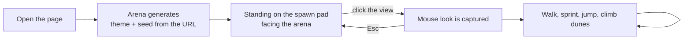
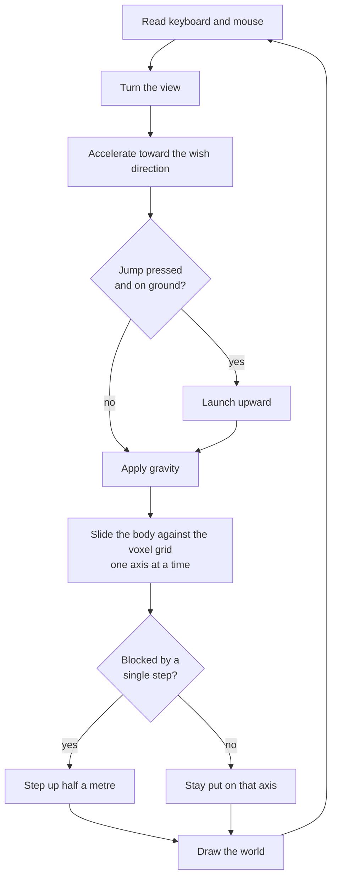
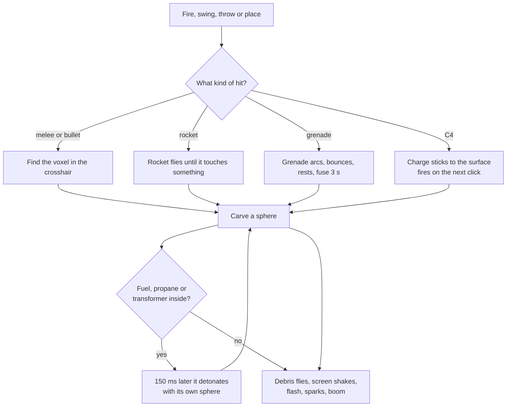
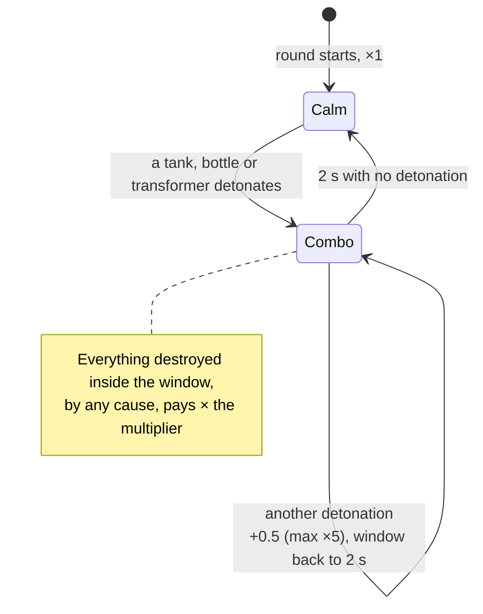
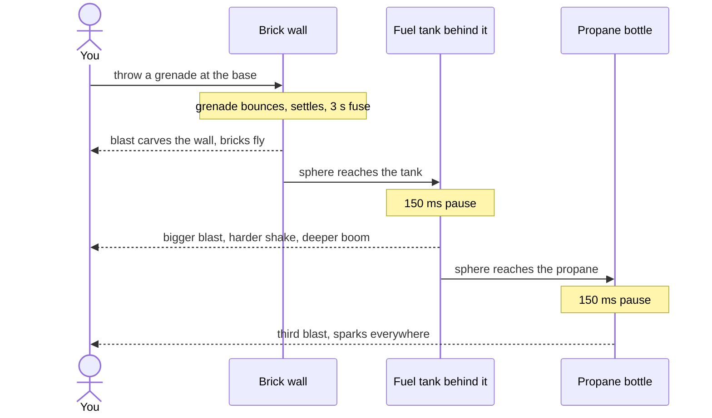
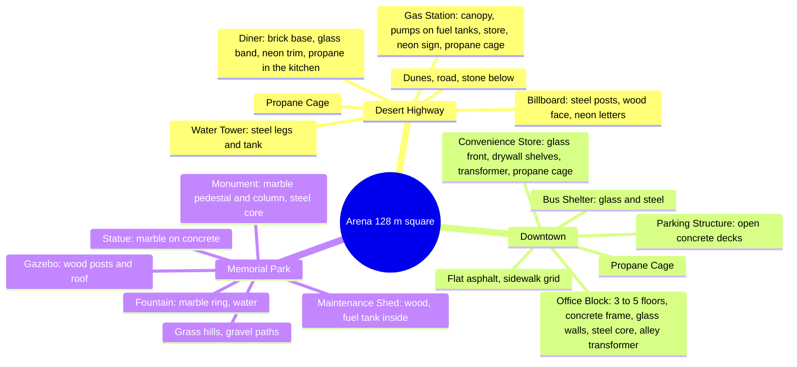

# Voxel Wreck — Player Flow (living document)

This describes the game **as a player experiences it at the current commit**. Nothing here is drawn ahead of the build. Missing mechanics are listed at the end under "Not yet playable".

## Screens that exist today

There is one screen: the arena. The page opens straight into it. Theme and seed come from the address bar; there is no menu, picker or results screen yet.

What the player sees: a sunlit voxel arena with six to ten structures from the theme's pool standing on flattened pads, a small caption at the top naming the theme and seed, and an optional stats readout (F3) that also shows the running score, the multiplier and the arena's percent wrecked. Adding `test=wall` to the address stamps a test wall with a fuel tank behind it near the spawn.

## The in-round loop as it works now

There is no clock yet, so a "round" never ends. Score is kept but only shown in the stats readout; there is no HUD.

### Wrecking something

Every hit, from a pickaxe tap to a C4 charge, carves a sphere out of the world. Harder materials need more energy, and energy fades toward the edge of the sphere.

## Scoring as it works now

Only structure voxels pay. Terrain is free to dig. Each destroyed structure voxel pays its material's value (glass 1 … steel 8) times the current combo multiplier.

Leveling a structure (100 % of its value destroyed) pays a one-time bonus of half its total value. Every 1,000 points is a milestone: a stinger plays and a reward drops, cycling grenade → rocket → C4 → time. The ammo rewards are added to the loadout; the time reward has nothing to add to yet.

## A dramatic moment: grenade through a brick wall

## Controls that work

| Key | Action |
| --- | --- |
| Mouse | Look (after clicking the view) |
| W A S D | Move |
| Shift | Sprint |
| Space | Jump |
| Mouse 1 | Fire, swing, throw, place C4 (click again to detonate) |
| Mouse 2 | Aim: tighter spread (C4: detonate) |
| 1–8, wheel | Switch weapon |
| R | Reload |
| G | Throw a grenade from any weapon |
| Esc | Release the mouse |
| F3 | Toggle the stats readout |

## The loadout

Everyone carries the same eight slots. Ammo is for the whole round; nothing refills yet.

| Slot | Weapon | How it hits | Good against | Ammo |
| --- | --- | --- | --- | --- |
| 1 | Pickaxe | Short swing, one voxel at a time | Anything up to concrete, slowly | Unlimited |
| 2 | Bat | Wide slow swing | Glass, drywall, wood | Unlimited |
| 3 | Pistol | One voxel per shot | Glass, drywall, wood; sets off tanks | 12 per mag, 72 total |
| 4 | Shotgun | Eight pellets in a cone | Walls up close, even concrete | 6 per mag, 30 total |
| 5 | Rifle | Full auto, 10 per second | Brick and concrete | 30 per mag, 120 total |
| 6 | Rocket launcher | Explodes on contact, 3 m sphere | Whole walls at range | 6 |
| 7 | Grenade | Bounces, 3 s fuse, 2.5 m sphere | Rooms and anything soft | 8 |
| 8 | C4 | Stuck to a surface, 4 m sphere, all charges fire together | Concrete | 4 |

## The arenas and what stands in them

Same theme and seed always build the same arena. Structures never float: each stands on a pad flattened into the terrain. Each theme totals roughly 15,000 (park) to 100,000 (downtown) points.

## Not yet playable

Mechanics from SPEC.md that do not exist for the player at this commit:

- Seeing the score, multiplier, combo ring, structure readout ("GAS STATION 78 % · 1,240 pts"), "LEVELED" stamp or milestone callouts on screen; they exist as events only.
- The +5 s milestone reward (no clock to add it to).
- The 3-minute round clock and the round-end slow motion.
- The radial weapon picker (Q / wheel fan-out) and its slow motion; aim-zoom (aiming only tightens spread today).
- Hit markers, crosshair, any on-screen ammo or weapon readout (ammo is tracked but not shown).
- Start menu, world picker, loadout briefing, countdown, pause, results, initials entry, leaderboard.
- Settings (sensitivity, volume, FOV).
- The server: sessions, score submission, leaderboard storage.

## Changelog

- 2026-11-04: Phase 3 — three arenas with fourteen structure types, scoring with combos, leveled bonus and milestones
- 2026-11-04: Phase 2 — all eight weapons fire, carving, chain reactions, debris, effects and sound; test wall harness
- 2026-11-04: Initial snapshot at 580cf52
