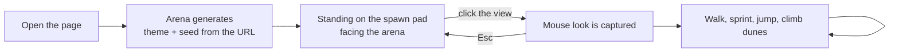
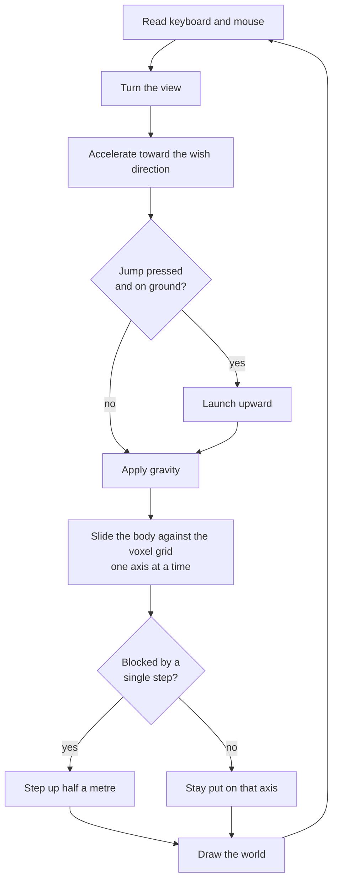
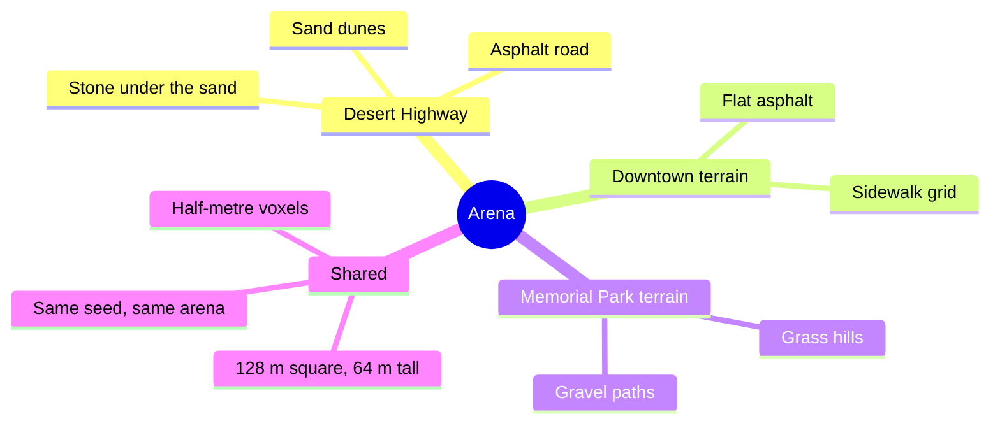

# Voxel Wreck — Player Flow (living document)

This describes the game **as a player experiences it at the current commit**. Nothing here is drawn ahead of the build. Missing mechanics are listed at the end under "Not yet playable".

## Screens that exist today

There is one screen: the arena. The page opens straight into it. Theme and seed come from the address bar; there is no menu, picker or results screen yet.

What the player sees: a sunlit voxel desert with rolling dunes and one asphalt road through the middle, a small caption at the top naming the theme and seed, and an optional stats readout (F3).

## The in-round loop as it works now

There is no clock, no score and no weapons yet. The loop is movement only.

## Controls that work

| Key | Action |
| --- | --- |
| Mouse | Look (after clicking the view) |
| W A S D | Move |
| Shift | Sprint |
| Space | Jump |
| Esc | Release the mouse |
| F3 | Toggle the stats readout |

## The arena today

All three terrains generate from a seed. No structures stand on any of them yet, so there is nothing to score and nothing to wreck.

## Not yet playable

Mechanics from SPEC.md that do not exist for the player at this commit:

- Any destruction: no weapon fires, swings, throws or places anything, so nothing can be carved.
- Debris, screen shake, flashes, particles, sounds.
- Chain reactions through fuel tanks, propane or transformers (nothing volatile is placed in the world).
- Structures: gas station, diner, billboard, water tower, propane cage, convenience store, office block, parking structure, bus shelter, monument, fountain, gazebo, statue, maintenance shed.
- Scoring, combo multiplier, leveled bonus, milestones and rewards.
- The 3-minute round clock and the round-end slow motion.
- The weapon loadout, weapon switching, the radial picker, ammo and reloading, view models.
- Start menu, world picker, loadout briefing, countdown, pause, results, initials entry, leaderboard.
- Settings (sensitivity, volume, FOV).
- The server: sessions, score submission, leaderboard storage.

## Changelog

- 2026-11-04: Initial snapshot at 580cf52
